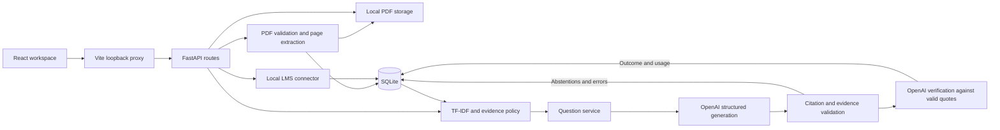

# Architecture

EduEvidence is a local, single-operator Windows application for Project 022. The root of trust is the operator's selection of approved, synthetic course PDFs. The browser talks to Vite on loopback, which proxies API requests to FastAPI. SQLite records corpus revisions and question traces. Each retrieval fits scikit-learn TF-IDF over the current eligible chunks, ranks by cosine similarity and applies an evidence threshold before invoking the provider.

An upload reserves its hash in SQLite before writing a server-named PDF. Extraction runs in a worker after the upload returns. Reindexing publishes a new active revision in a single transaction. Deleted records are retired so historic citation excerpts and page previews remain available. Questions commit ranked passages before the OpenAI request. An answer that passes local validation goes through a separate quote-based verification call. The service commits the outcome, answer, citations and verification event atomically. Imports, feedback and document lifecycle operations carry request IDs in their audit events.

## LMS connector boundary

`LMSConnector` defines the learner and course catalog interface. `LocalLMSConnector` supplies synthetic SQLite rows. A future approved connector would use the institution's documented API, scoped authentication and explicit course entitlements. It would map approved external course and learner IDs into local records, record content approvals, and preserve the original source identifiers and download hashes. Production access requires authorization and a separate identity and tenant design.

## Development and verification checklist

1. Initialize the versioned schema and synthetic LMS connector.
2. Validate actual PDFs, implement ingestion and reindexing, and check page ancestry.
3. Implement filtered retrieval, prompt assets, provider integration and evidence validation.
4. Build seven connected pages and verify the main paths with keyboard and mobile browsers.
5. Generate the sample PDFs and sample database, run backend and browser tests, and inspect traces.
6. Attempt the live OpenAI flow with available credentials. Record the exact observed outcome.
7. Document acceptance, limitations and Windows startup, then package source and execution evidence.

