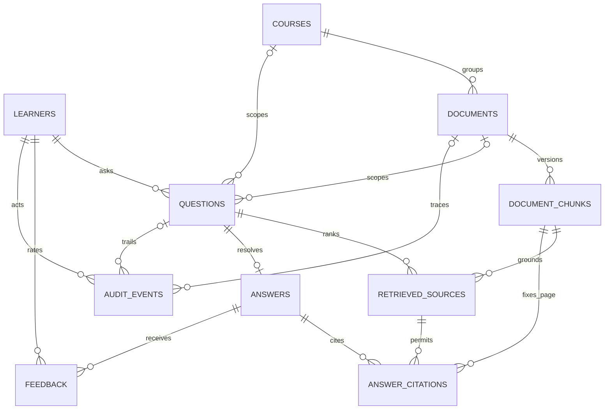

# SQLite design

Schema version 1 is initialized transactionally and recorded with `PRAGMA user_version`. Connections enforce foreign keys and use parameterized values. Writes use `BEGIN IMMEDIATE` and rollback on exception. WAL allows readers to inspect the workspace while writes complete. Timestamps are UTC with millisecond precision.

| Entity | Identity and integrity |
|---|---|
| Learners, courses | Stable synthetic keys and unique external identifiers or course codes. |
| Documents | Unique server storage name and unique active SHA-256. Status and job ID guard concurrent lifecycle changes. |
| Document chunks | Unique chunk number per document revision. Page and document form a composite identity with the chunk ID. |
| Questions | Optional course and document scopes, optional conversation UUID, and unique request UUID. |
| Retrieved sources | Unique chunk and unique rank per question. Stored cosine score belongs to the original retrieval. |
| Answers | One outcome per question. Provider metadata and prompt version survive failed validation. |
| Answer citations | Composite foreign keys enforce the answer's question, the retrieved set, and the chunk's actual document and page. |
| Feedback | One current rating per learner and answer. Each write adds an audit event. |
| Audit events | Correlation ID and related learner, document or question, with safe outcome details. |

The same PDF bytes can be reindexed. If the ordered page and content hashes match, the existing revision remains active and no duplicate chunks are inserted. A changed chunking configuration can produce a new active revision. Previous revisions remain available to historical question traces. Removal retires the document and excludes it from new searches. Historical page previews verify the stored PDF against the original hash before rendering.

The sample database is a SQLite backup of a freshly seeded synthetic workspace. Use the seed script's restore option to recreate its matching server-named PDFs. The SQLite sample contains no provider key or answering history.

